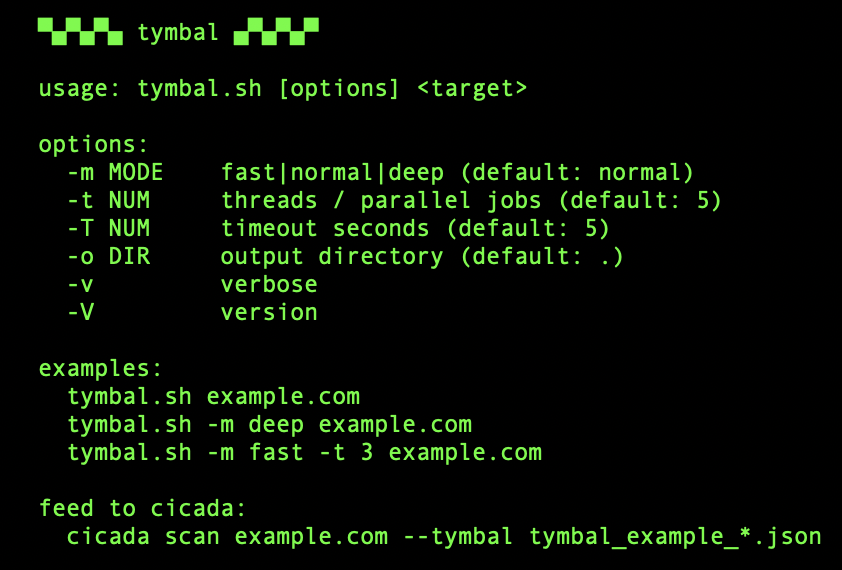
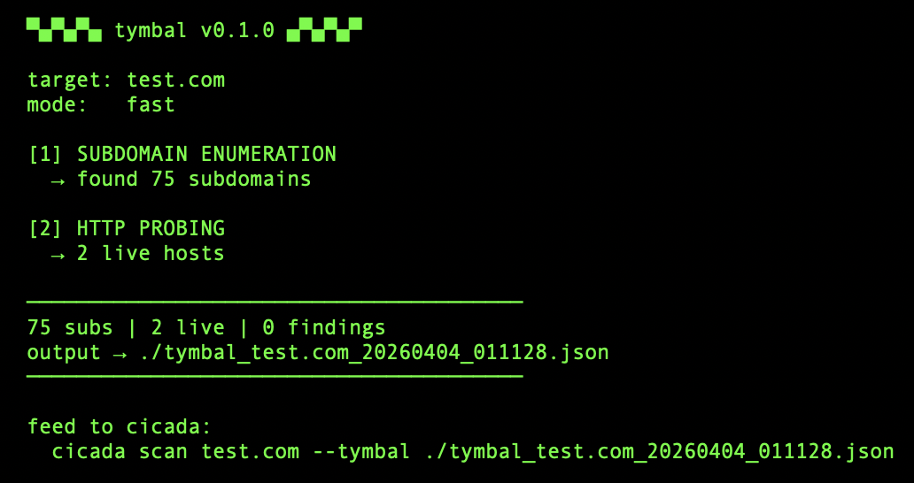
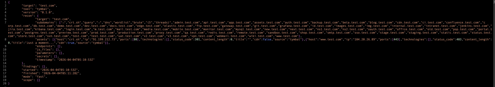

# Tymbal

Lightweight recon for [Cicada](https://github.com/zblauser/cicada). Runs on anything with a shell.<br>

Tymbal is a POSIX shell script that does subdomain enumeration, HTTP probing, port scanning, and basic security checks. It then outputs Cicada-compatible JSON.

<p align="center"></p>

No Python. No Go runtime. No node_modules. Just `sh`, `wget`, and whatever else your system already has.
Named after the organ cicadas use to produce sound.

## Run
There's nothing to install. Copy the script. Run it.
```
chmod +x tymbal.sh
```

### Dependencies (most are probably there)
**Required (at least one):**
- `wget` or `curl` — for crt.sh queries and HTTP probing<br>

**Recommended:**
- `nslookup` — for DNS brute force (`apk add bind-tools` on Alpine)
- `nc` (netcat) — for port scanning (`apk add netcat-openbsd` on Alpine)<br>

**Fallbacks:** <br>

If you don't have `nslookup`, Tymbal falls back to `host`, then `getent`, then `ping`. It works with whatever you've got. It just works better with more.

## Usage
```
sh tymbal.sh example.com                    # Normal Scan
sh tymbal.sh -m fast example.com            # Subdomains + Probe Only
sh tymbal.sh -m deep example.com            # Full Recon + Checks
sh tymbal.sh -m deep -t 3 example.com       # Low Threads for Constrained Devices
sh tymbal.sh -o /tmp example.com            # Custom Output Directory
```
### Modes
| Mode | What Happens |
|------|-------------|
| `fast` | subdomain enum (crt.sh + DNS brute) → HTTP probe |
| `normal` | fast + port scanning |
| `deep` | normal + CORS checks + header analysis |

### Options
```
-m MODE    fast | normal | deep (Default: normal)
-t NUM     Parallel jobs (Default: 5, Lower this on constrained devices)
-T NUM     Timeout per request in seconds (Default: 5)
-o DIR     Output Directory (Default: current)
-v         Verbose (Prints each host as it's probed)
-V         Version
```

## Feed to Cicada
This is the whole point. Run Tymbal for quick recon, bring the JSON home.

```
# Wherever you've got Tymbal
sh tymbal.sh -m deep example.com

# On your workstation
python3 cicada.py scan example.com --tymbal tymbal_example_20260402.json
```

Cicada merges everything Tymbal found; subdomains, live hosts, open ports, findings, with its own deep scanning. No duplicates. The JSON schema is identical between the both tools.

## What It Actually Does
**Subdomain Enumeration:**
- Queries crt.sh certificate transparency logs
- DNS brute force with a built-in 70-word list (common prefixes like api, dev, staging, admin, etc.)
- Deduplicates and sorts results
**HTTP Probing:**
- Tries HTTPS then HTTP for each subdomain
- Grabs status code, page title, server header, technology headers
- Detects CDN (Cloudflare, CloudFront, Akamai, Fastly, Varnish)
- Resolves IP addresses
**Port Scanning** (normal/deep):
- Scans 13 common ports (22, 80, 443, 3000, 3306, 5432, 8080, etc.)
- Uses netcat, falls through gracefully if unavailable
**Security Checks** (deep only):
- Missing HSTS, X-Content-Type-Options, Content-Security-Policy headers
- CORS misconfiguration (wildcard origin, origin reflection, null origin)

## Output
Single JSON file, Cicada-compatible:
```
tymbal_example_20260402_120000.json
```
Contains subdomains, live assets, open ports, and findings. Readable by Cicada's `--tymbal` flag or `cicada ingest` command.

<p align="center">
</p>


## On Something Like an Alpine Setup
```
apk add wget bind-tools netcat-openbsd
chmod +x tymbal.sh
sh tymbal.sh -m deep -t 3 example.com
```

That's it. Lower the thread count (`-t 3` or even `-t 1`) if it is struggling.

## Using Go Instead
There's also a Go implementation in `cmd/` and `pkg/` if you're on a non-constrained platform where Go's runtime doesn't implode. Build with `go build -o tymbal ./cmd/tymbal`. Same features, faster execution, same JSON output. But the shell script is the primary; it runs everywhere, and everywhere is the point.

## Why though?
Because sometimes you're on an iPhone running [iSH](https://github.com/ish-app/ish) with Alpine Linux, and still want to do some recon. Sometimes you're on a locked down VPS with nothing but busybox. Maybe because Go's runtime crashes on iSH (ask me how I know), and certain Python libraries aren't always an option.
Tymbal runs where other tools won't. It speaks the same JSON as Cicada, so you do the lightweight recon from wherever you are, then feed results into the full pipeline when you get home.

## A Note on AI and Bug Bounties [Read Before Using This Tool]
Tymbal finds subdomains and surfaces the attack area. It does not find vulnerabilities for you. The "findings" it reports (missing headers, CORS issues) are starting points for investigation, not finished bug reports. Verify everything manually before submitting anywhere. Automated recon is the first step, not the last one.
## Contributing

If you share the belief that simplicity empowers creativity, feel free to contribute.

#### Contribution is welcome in the form of:
- Forking this repo
- Submiting a Pull Request
- Bug reports and feature requests

Please ensure your code follows the existing style.

## Thank you for your attention.
If you hit any issues, feel free to open an issue on GitHub.
Pull requests, suggestions, or even thoughtful discussions are welcome.

